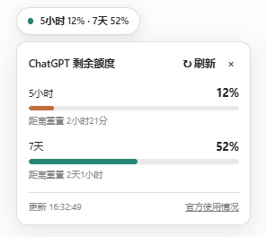

# ChatGPT Quota Dock / ChatGPT 额度速览

> 一个非官方的 Edge / Chrome + Tampermonkey 用户脚本，在 ChatGPT 页面直接查看可读取的额度窗口与重置倒计时。

**状态：实验性。** 已通过 JavaScript 语法检查和模拟接口测试；尚未在所有 ChatGPT 账号、套餐和新版网页上验证。OpenAI 可能随时修改网页内部接口。

## 界面预览 / Preview

下面是用户实际运行时的截图（非模拟数据）。悬浮面板直接展示 5 小时、7 天额度的剩余比例及重置倒计时。



> 截图仅展示拍摄时的实际使用情况，具体额度取决于当前账号及官方接口返回的数据。

## 功能

- 页面右上角显示可读取的额度剩余百分比，点击查看详情
- 显示 5 小时、7 天等接口提供的额度窗口及重置倒计时
- 自动每 5 分钟刷新、支持手动刷新
- 面板可折叠、拖动、保存位置
- 请求失败时显示错误信息，不虚构剩余额度
- 只调用 ChatGPT 当前网站的同源接口；不向第三方发送用量数据、登录令牌

## 安装（Edge）

1. 安装 [Tampermonkey](https://www.tampermonkey.net/) 浏览器扩展。
2. 在 Edge 的 `edge://extensions` → **Tampermonkey → 详细信息** 中启用 **「允许用户脚本」(Allow user scripts)**；部分 Edge 版本还需要开启 **开发人员模式**。
3. 点击下方链接安装，确认 Tampermonkey 的安装提示：

**[一键安装 ChatGPT Quota Dock](https://raw.githubusercontent.com/marce006982/chatgpt-usage-dock/main/chatgpt-usage-dock.user.js)**

也可以打开 Tampermonkey 的「添加新脚本」，粘贴 [脚本源码](chatgpt-usage-dock.user.js)，保存后刷新 https://chatgpt.com。

> 已安装旧版本时，请先禁用旧脚本，以免两个额度浮窗同时显示。

## 使用

打开 ChatGPT，页面右上方将出现「额度读取中…」标签，成功后显示如「5小时 76% · 7天 42%」的概览。**这些数字只是示例**，真正显示的数字来自当前账号的接口返回值。点击标签展开详情，拖动面板标题可改变位置。

- 悬浮按钮没有出现：先检查 Tampermonkey 是否在当前网站启用，Edge 是否开启「允许用户脚本」，然后按 `Ctrl+Shift+R`。
- 按钮出现，但显示「接口未返回可识别的额度窗口」：账号或网页版本可能没有返回 `used_percent` 数据，脚本不会推测额度。
- 显示 401 / 403：刷新页面重新登录；部分账号可能限制该接口。
- 显示 404：内部用量接口可能发生变化，可以提交 Issue 并附上**不含敏感信息**的错误描述。

## 原理和隐私

该脚本请求 ChatGPT 网站自己的 `/api/auth/session` 与 `/backend-api/wham/usage` 接口。必要时使用会话令牌在本地浏览器内完成请求，但**不会把令牌写入本地存储或传输到其他网站**。唯一持久保存的数据是面板是否展开与拖动位置。

这些接口并非面向第三方提供的正式公共 API，数据字段、可用性、不同套餐的额度口径都可能变化。显示的百分比是基于服务端 `used_percent` 计算的剩余比例，**不是精确的剩余提问次数或可用 token 数**。

## 开发

需要 Node.js 18 或更新版本：

```bash
npm test
```

测试覆盖：脚本语法、面板挂载、额度读取、额外额度窗口、错误状态；数据来自模拟接口，不是实时账号验证。

## 开源协议

MIT。此项目与 OpenAI 没有官方关联。
